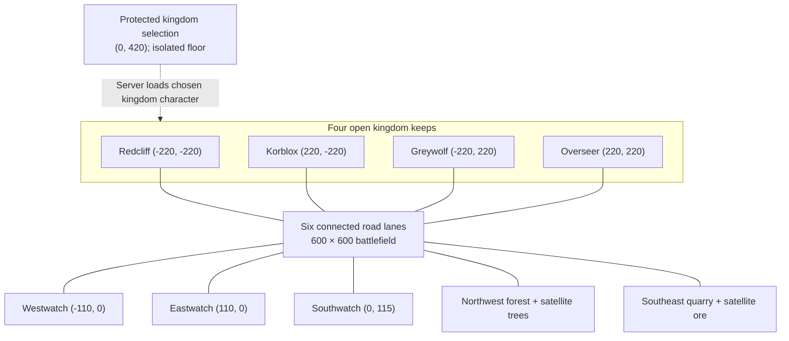
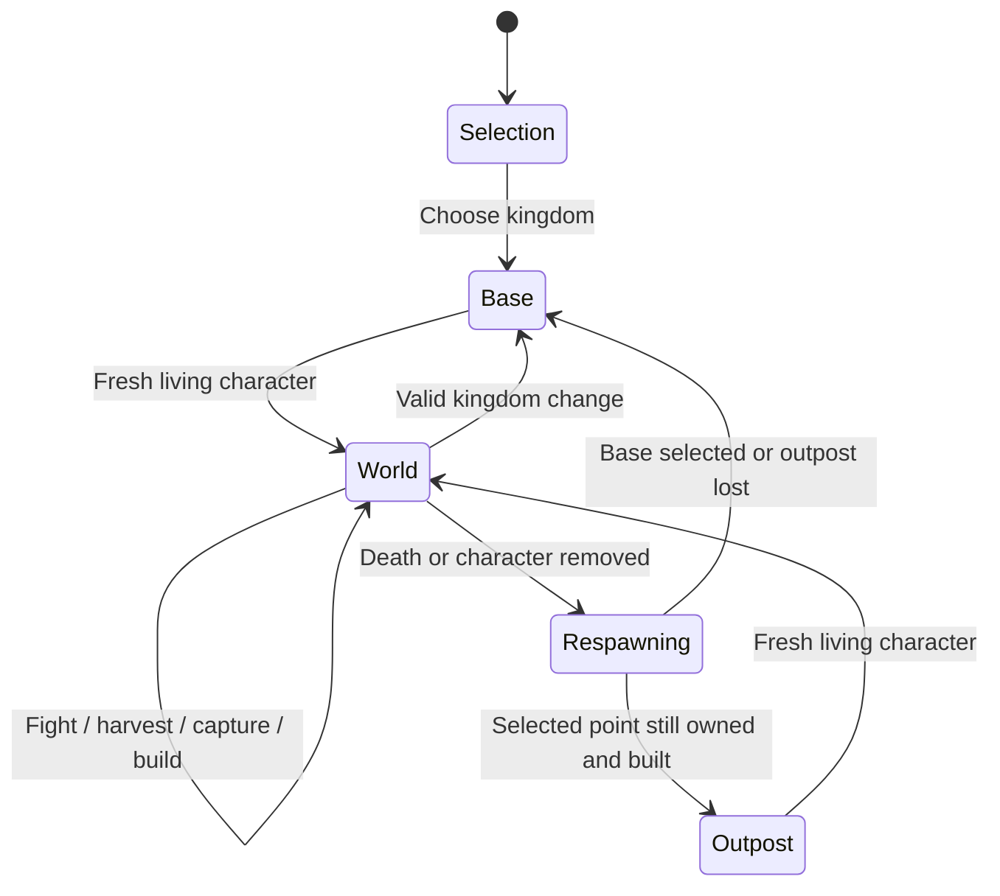
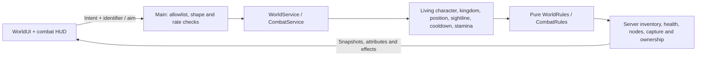

# Kingdom world schematics

The default `Config.Game.Mode = "Kingdoms"` runs an original Roblox kingdom battlefield with sword attacks, stamina, recovery, gathering and flags. There are no parry or kick actions. Set the mode to `"Lobby"` to run the retained invitation-based duel workflow.

**Reference calibration is pending.** The [official wiki](https://official-medieval-warfare-reforged.fandom.com/wiki/Official_Medieval_Warfare_Reforged_Wikia) and videos [1](https://youtu.be/eUGhfbq57IM), [2](https://youtu.be/OVU1nEp7prw), [3](https://youtu.be/MnnWU00xANA) could not be viewed: proxy CONNECT requests returned HTTP 403. The draft network configuration includes reference hosts, but runtime access remains blocked. Every number below, the four kingdom identities, map and visual design are inherited or newly chosen project defaults; none are verified Medieval Warfare Reforged facts. Gameplay has no wiki or video network dependency.

## World layout

Coordinates above are `(X, Z)` studs. Ground tops are `Y=0`; character root spawns are `Y=3.5`. There are **394 static primitives, 16 kingdom spawn positions, eight selection spawns, 16 harvestable trees, 12 ore nodes and three initially neutral outposts**. Each outpost has a flag and nine initially hidden buildable parts. Its spawn is ten studs south of the capture center. All scenery uses original primitives without external art assets.

`WorldMapBuilder.Build()` supplies the same geometry used by `assets/Kingdoms.rbxmx`. The CLI exporter checks floor support, standing clearance, connected walking access, harvest sightlines, six clear road lanes and outpost spawns with structures built. These checks approximate collision geometry; Roblox engine validation is still required.

## Combat and recovery tuning

Edit [Config.luau](../src/shared/Config.luau) to tune these defaults. Distances are studs; times are seconds.

| Setting | Current default |
| --- | --- |
| Health / stamina maximum | 100 / 100 |
| Walking / sprinting speed | 16 / 24 studs/s |
| Sword damage / stamina cost | 25 / 10 |
| Sword range / total attack arc | 8 / 110° |
| Sword windup / cooldown | 0.08 / 0.45 |
| Moving sprint stamina drain | 1/s |
| Stamina regeneration / delay after spending | 5/s / 1.5 |
| Health regeneration / delay after damage, attacking or gathering | 2 HP/s / 8 |
| Spawn protection | 3; an offensive sword attack ends the attacker's protection |
| Small potion (`Z`) | Heal 20; three per life |
| Medium potion (`X`) | Heal 45; two per life |
| Large potion (`C`) | Heal 75; one per life |
| Shared cooldown across all potion sizes | 60 |
| Combat-service action rate budget | 30/s |

Server ingress also applies a 12-actions/s token budget with a 20-action burst cap. Sword swings alternate sides and can damage at most one living enemy within range, arc and line of sight. Friendly damage is rejected. Gathering uses the same sword swing lock and stamina pool as combat, so a player cannot harvest and attack simultaneously. Sprint drains stamina only while moving and stops at exhaustion. Recovery clamps at the maximum and does not revive dead characters. Potions consume stock only when accepted; full-health use is rejected.

## Kingdom and world tuning

| Setting | Current default |
| --- | --- |
| Death respawn delay | 5 |
| Kingdom change cooldown / safe interval since combat or gathering | 60 / 8 |
| Harvest range / interval / stamina per accepted strike | 12 / 1 / 10 |
| Tree depletion / final-strike reward / regrowth | Four hits / eight wood / 45 |
| Ore depletion / final-strike reward / respawn | Five hits / five ore / 60 |
| Capture radius / uninterrupted capture duration | 18 / 15 |
| Building interaction range | 20 |
| Outpost building cost | 30 wood + 15 ore |
| Kingdom RGB colors | Redcliff `(184,53,47)`; Korblox `(54,105,151)`; Greywolf `(107,114,126)`; Overseer `(54,109,65)` |

The first kingdom choice is immediate. Further changes require a living character, the cooldown and the safe interval; a pending swing also blocks changes. Selection respawns at the new base and clears any selected outpost spawn.

Resource hits are shared by everyone on that server. Only the player delivering the depletion strike receives its entire reward. A depleted resource disappears, becomes noncolliding and returns on its timer. Accepted strikes require server-verified range, line of sight, cooldown and stamina.

A living player inside a flag radius advances capture for their kingdom. More allies do not accelerate it. Two or more different kingdoms freeze capture and mark it contested. Empty zones or owner-only presence decay a challenger’s progress at the same rate; a different sole challenger starts a new claim. Ownership transfers when progress completes and removes the previous fortification. A member of the owning kingdom may spend resources to build while nearby and uncontested. Owned, built outposts become selectable respawns; losing ownership or the structure causes respawn to fall back to the kingdom base.

Wood, ore, kingdom membership, kills/deaths, resource damage and outpost ownership are **session state**. Inventory survives death and kingdom changes; leaving resets that player's world state, and a new server starts a fresh world. Fresh characters restore health, stamina and potion stock. Existing cosmetic/coin profiles retain their separate profile persistence; no world persistence schema was added.

## Controls

| Input | Action |
| --- | --- |
| WASD / Roblox movement controls | Move; use Roblox jump controls to jump |
| Left mouse / touch sword button | Sword attack |
| Hold Shift / touch sprint control | Sprint |
| Ctrl / camera-lock button | Toggle shoulder camera lock |
| `E` / nearby resource's Harvest button | Chop tree or mine ore |
| `M` / Kingdom button | Open kingdom and outpost menu |
| Menu kingdom card | Choose or change kingdom |
| Nearby Build button or menu outpost card | Build an owned outpost |
| Menu outpost card / reset-to-base button | Select built outpost respawn / restore base respawn |
| `Z`, `X`, `C` / potion buttons | Drink small, medium or large potion |
| Hold Tab | Show scoreboard |

The world HUD displays resource totals, nearby node hits/regrowth, flag ownership/capture/contest state, build requirements, kingdom cooldown and death countdown. Menus suppress combat clicks; text entry and processed UI input suppress gameplay hotkeys.

## Build and validate

Run `make setup` for checksum-verified Rojo 7.7.1 and Luau 0.742 on Linux x86-64; `make check` compiles Luau and runs pure-rule and service-double tests. `make map` exports both maps, `make build` writes `build/FerEtFioles.rbxlx`, and `make serve` starts Rojo. `make studio-test` builds the legacy smoke-test place; it does not execute Studio. `make package` builds both places and refreshes the distributable ZIP and release files.

The CLI cannot establish engine or multiplayer correctness. In Roblox Studio, open the main place and run a local server with at least two clients:

1. Confirm selection protection, four base arrivals, kingdom menu cooldown and safe-interval rejection.
2. Attack enemies; verify friendly immunity, blocked sightlines, swing cooldown, stamina, sprint exhaustion and delayed health regeneration.
3. Gather through depletion; verify final-strike rewards, no simultaneous attack/harvest, shared node removal and timed return.
4. Capture all flags; verify contested freezing, abandonment decay, resource spending and visible fortification.
5. Select an outpost spawn, die and confirm its location; transfer ownership before respawn and confirm base fallback.
6. Check inventory retention across death, fresh potion stock, reconnect reset, mobile controls, menus and scoreboard. Inspect client/server Output for errors.
