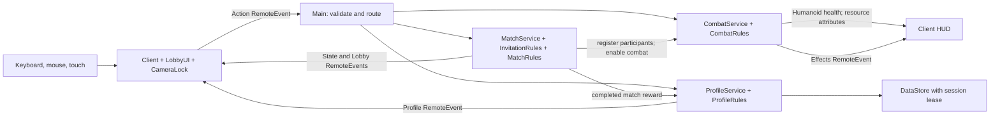

> Historical lobby-mode documentation. The current default kingdom world, health regeneration and world systems are documented in [KINGDOM_WORLD.md](KINGDOM_WORLD.md). The earlier no-regeneration/lobby-only requirements below have been superseded by the current request.

# Gameplay reference schematics

This describes the **current Fer & Fioles implementation**, not verified Medieval Warfare Reforged behavior. None of the three videos could be viewed: requests were blocked by the environment proxy with HTTP 403. Every number below is a current project setting, provisional for reference matching. No gameplay setting was changed on the basis of unseen footage.

Requested references: [video 1](https://youtu.be/eUGhfbq57IM), [video 2](https://youtu.be/OVU1nEp7prw), [video 3](https://youtu.be/MnnWU00xANA). No timestamps or observations have been established for them.

## Multiplayer responsibilities



The server owns damage, stamina, potion stock, cooldown acceptance, rosters, purchases and rewards. The client submits intent and displays replicated results. MapBuilder generates the original lobby and arena. One arena supports one human-only duel or 2v2 at a time; other players remain in the lobby.

Sources: [Main](../src/server/Main.server.luau), [CombatService](../src/server/CombatService.luau), [MatchService](../src/server/MatchService.luau), [ProfileService](../src/server/ProfileService.luau).

## Match lifecycle

```mermaid
stateDiagram-v2
    [*] --> Lobby
    Lobby --> PendingInvite: Host selects 1v1 or 2v2 participants
    PendingInvite --> Lobby: Reject, cancel, leave, or expire after 25 s
    PendingInvite --> Preparing: Every invited player accepts
    Preparing --> Lobby: Loading fails, player leaves, or 20 s timeout
    Preparing --> Battle: Every roster character ready
    Battle --> Battle: Death eliminates player; player spectates
    Battle --> Results: Last surviving team or double elimination
    Results --> Lobby: 6 s elapsed
```



`PendingInvite` is an invitation state while players' activity remains `Lobby`. The roster locks before loading. Combatants receive fresh resources; spawn protection is rebased when battle begins. Battles have no time limit and no automatic rematch. Leaving during battle marks a forfeit and suppresses rewards for that match. Successful elimination results award 50 coins per winner, 10 per loser, or 10 each for a draw, once per match ID.

## Combat and resource settings

All table values come from [Config](../src/shared/Config.luau), [CombatRules](../src/shared/CombatRules.luau) and [CombatService](../src/server/CombatService.luau).

| Mechanic | Current implementation |
| --- | --- |
| Health | 100 maximum; no passive regeneration |
| Stamina | 100 maximum; resets with combat registration |
| Walk / sprint speed | 16 / 24 Roblox studs per second |
| Sprint cost | 1 stamina/s while sprint is active and horizontal physical speed exceeds 0.75 studs/s; stops at zero |
| Stamina recovery | 5/s after 1.5 s without spending; capped at 100; only eligible time within a frame regenerates |
| Attack cost / damage | 10 stamina per accepted swing, including a miss; 25 damage per successful hit |
| Attack cooldown | 0.45 s between accepted swings; server enforces it independently of the client |
| Attack windup | Resolve on the first server step at or after 0.08 s from acceptance |
| Attack geometry | Maximum root-to-root distance 8 studs; 110-degree horizontal cone; line-of-sight raycast; nearest eligible visible enemy only |
| Aim | Camera direction supplied with the request, flattened and validated server-side; used when that attack resolves |
| Swing animation | Alternating horizontal directions, advanced only on accepted swings; sword Motor6D tween lasts 0.24 s; locomotion remains available |
| Friendly fire | Disabled; self and dead targets also excluded |
| Spawn protection | 3 s from battle start; an accepted attack ends the attacker's own protection |
| Small potion | Z; +20 health; 3 per combat |
| Medium potion | X; +45 health; 2 per combat |
| Large potion | C; +75 health; 1 per combat |
| Potion cooldown | One shared 60 s cooldown, beginning on successful consumption; all sizes lock together |
| Potion acceptance | Instant healing capped at maximum; full health, empty stock, death or cooldown consumes nothing |
| Combat availability | Registered living participants during Battle; lobby cannot attack, sprint through combat actions, or drink |
| Equipment | All swords share combat stats; sword and faction choices are cosmetic |

The current action set is attack, sprint and potion. Block, parry, kick and other special combat actions are not implemented; this says nothing about their presence in the reference game. Roblox's normal locomotion and jump controller remain active. [Health.server](../src/character/Health.server.luau) suppresses Roblox's default passive healing.

```mermaid
sequenceDiagram
    participant C as Client
    participant S as Server
    participant T as Target Humanoid
    C->>S: Attack with horizontal aim
    S->>S: Validate participant, rate, aim, cooldown and stamina
    alt Rejected
        S-->>C: Optional feedback; no stamina spent
    else Accepted
        S->>S: Spend 10; record attack/spend time; alternate swing
        S-->>C: Replicate resources and Swing effect
        S->>S: After 0.08 s, check distance, cone and raycast
        opt Eligible visible enemy found
            S->>T: TakeDamage(25), once
            S-->>C: Hit effect; elimination if lethal
        end
    end
```

## Controls and presentation

| Input | Current action |
| --- | --- |
| Standard Roblox movement / jump | Move, look and jump |
| Left mouse click | One sword attack; holding does not auto-repeat |
| Left or right Shift held | Sprint during battle |
| Left or right Ctrl | Toggle shoulder camera lock |
| Z / X / C | Small / medium / large potion |
| Tab held | Show player scoreboard; release hides it |
| MENU PvP and menu buttons | Invitations, shop and faction selection in the lobby |
| Touch buttons | Attack, held sprint, potion slots, camera lock and menus |

The HUD shows health, stamina, potion stock, shared cooldown seconds, protection, living team counts, elapsed battle time, session team wins, hit feedback and elimination/spectating status. The scoreboard shows player kills and deaths. Health turns red at 25% or less; stamina turns red below the 10-stamina attack cost. Ctrl applies a shoulder offset of (1.75, 0.25, 0) studs and aligns facing with camera yaw. Menus, text entry, lost focus and spectating suspend camera lock. Sources: [Client](../src/client/Client.client.luau), [CameraLock](../src/client/CameraLock.luau), [LobbyUI](../src/client/LobbyUI.luau).

## Other active timings

| Setting | Current behavior |
| --- | --- |
| Invitation cooldown / expiry | Host waits 15 s between successful invitations; pending invitation expires after 25 s |
| Preparation / results / lobby respawn | At most 20 s loading; 6 s result display; 3 s lobby respawn delay |
| Server simulation | Combat, match and profile steps run on Heartbeat |
| Resource / match / lobby updates | Resource attributes at roughly 0.1 s intervals; match snapshots 0.5 s; lobby snapshots 1 s, plus event-driven updates |
| HUD / spectator refresh | Roughly 0.08 s HUD refresh and 0.3 s spectator target refresh |
| Request limits | Main bucket: capacity 20, refill 12/s; combat bucket: capacity/refill 30/s; invitation bucket: capacity 12, refill 6/s. These are request guards, separate from gameplay cooldowns |
| Feedback | Rejection toast dispatch at most once per 1.5 s; toast visible 3.2 s; hit marker 0.5 s |
| Persistence | Autosave every 60 s; session lease 180 s; save on departure and shutdown |

`Config.Game.IntermissionSeconds = 8` is a legacy unused setting; the invitation lifecycle does not run an eight-second intermission. DataStore availability and lease status determine whether the profile is persistent, session-only, or unavailable.

## Evidence needed for faithful calibration

Accessible recordings or screenshots need visible HUD values, timestamps and the relevant weapon/equipment context. Continuous normal-speed footage of repeated swings, sprinting from full stamina to exhaustion, recovery after spending, and successive potion attempts would establish costs and timing intervals. Before/after health and stock readings distinguish accepted actions from input attempts. Frame rate, editing, latency and rounded HUD values limit timing precision; hidden server constants cannot be recovered exactly from a display alone.

For each confirmed mechanic, record the video ID and timestamp range, action and starting state, observed change, measured interval and uncertainty, then map it to the relevant setting or service above. UI, animation and map comparisons require clear frames from each relevant screen/angle. Until that evidence is available, all Medieval Warfare Reforged comparisons remain unverified; the current values are not reference measurements.
